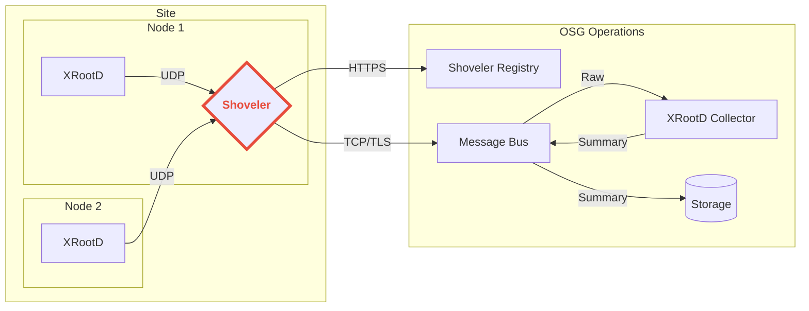

title: Installing the XRootD Monitoring Shoveler

Installing the XRootD Monitoring Shoveler
=========================================

The [XRootD Monitoring Shoveler](https://github.com/opensciencegrid/xrootd-monitoring-shoveler)
is designed to accept the XRootD monitoring packets and "shovel" them to the OSG message bus.
Shoveling is the act of moving messages from one medium to another.
In this case, the shoveler is moving messages from a UDP stream to a message bus.

The shoveler authenticates to the message bus with short-lived tokens that it fetches itself from the
OSG Shoveler Registry.
On its first start, the shoveler registers with the registry and waits until OSG Operations approves it.
After that, it keeps its own credentials fresh: there are no tokens to copy around or renew by hand.



!!! note
    The Shoveler is for use by XRootD standalone installs and XCache-based cache and origin installs.
    It is not necessary to install it for a Pelican-based cache or origin.

The installation has five steps, each covered in its own section below:

1.  [Install the shoveler](#installing-the-shoveler)
1.  [Configure the shoveler](#configuring-the-shoveler) to use the OSG Shoveler Registry
1.  [Configure XRootD](#configuring-xrootd-to-send-monitoring-packets) to send its monitoring packets to the shoveler
1.  [Start the shoveler](#starting-the-shoveler-and-registering), which registers itself with the registry
1.  [Request approval](#requesting-approval) by opening a ticket with OSG

Before Starting
---------------

Before starting the installation process, consider the following points:

-   **Version:** Registration with the OSG Shoveler Registry requires `xrootd-monitoring-shoveler` 2.4.0 or newer.
-   **User IDs:** If it does not exist already, the installation will create the Linux user ID
    `xrootd-monitoring-shoveler`, which the service runs as.
-   **Incoming UDP:** An open port (default `9993`) that can receive UDP packets from the XRootD servers on the
    shoveler host.
    It does not need to be open to the internet, only to the XRootD servers.
-   **Outgoing network access** from the shoveler host to:
    -   The OSG Shoveler Registry, `https://xrd-shoveler-auth.osg-htc.org` (TCP port 443)
    -   The OSG message bus, `clever-turkey.rmq.cloudamqp.com` (AMQPS, TCP port 5671)
-   **Persistent storage:** The shoveler keeps its private key, registration, and access token in
    `/var/lib/xrootd-monitoring-shoveler/`, and its on-disk message queue in `/var/spool/xrootd-monitoring-shoveler/`.
    Both directories must survive restarts and upgrades.
    If `/var/lib/xrootd-monitoring-shoveler/` is lost, the shoveler has to register and be approved again.

As with all OSG software installations, there are some one-time (per host) steps to prepare in advance:

-   Ensure the host has [a supported operating system](../../release/supported_platforms.md)
-   Obtain root access to the host
-   Prepare [the required Yum repositories](../../common/yum.md)

### Resource requirements

1.  **RAM**: Production shovelers use less than 50MB of memory.
1.  **Disk**: If the shoveler is disconnected from the message bus, or is waiting to be approved, it stores the
    messages on disk until it can send them.
    Through testing, a disconnected shoveler with 12 busy XRootD servers will generate <30 MB of data a day on disk.
1.  **CPU**: A production shoveler will use 1-2% of a CPU, depending on how many XRootD servers are reporting to it.
    A shoveler with 12 busy XRootD servers reporting to it uses 1-2% of a CPU.
1.  **Network**: A production shoveler receives UDP messages from XRootD servers and sends them to a message bus.
    The incoming and outgoing network utilization will be the same.
    In testing, a shoveler will use <30MB of data a day on the network.

Installing the Shoveler
-----------------------

The shoveler can be installed via RPM, DEB, or container.
A single shoveler can serve every XRootD server at a site, so most sites only need one.

### Installing the RPM

Install the shoveler from the OSG Yum repositories:

```console
root@host # yum install xrootd-monitoring-shoveler
```

Alternatively, download the RPM (or DEB) for your platform from the
[latest release on GitHub](https://github.com/opensciencegrid/xrootd-monitoring-shoveler/releases/latest)
and install it:

```console
root@host # yum install ./xrootd-monitoring-shoveler_Linux_x86_64.rpm
```

The package installs:

| File or directory                                              | Purpose                                                  |
|:---------------------------------------------------------------|:---------------------------------------------------------|
| `/etc/xrootd-monitoring-shoveler/config.yaml`                  | Configuration file                                       |
| `/usr/lib/systemd/system/xrootd-monitoring-shoveler.service`   | systemd service                                          |
| `/var/lib/xrootd-monitoring-shoveler/`                         | Private key, registration state, and access token        |
| `/var/spool/xrootd-monitoring-shoveler/queue/`                 | On-disk message queue                                    |
| `/usr/bin/shoveler-status`                                     | Tool for [checking a running shoveler](#validating-the-shoveler) |

If you are installing with a container instead, skip ahead to
[Running the shoveler in a container](#running-the-shoveler-in-a-container) after reading the configuration section.

Configuring the Shoveler
------------------------

Configuration can be specified with environment variables or a configuration file.
The configuration file is in `yaml`.
In the RPM, the configuration file is located in `/etc/xrootd-monitoring-shoveler/config.yaml`.

### Minimal configuration

For most sites, the following is a complete configuration file.
Replace the contents of `/etc/xrootd-monitoring-shoveler/config.yaml` with:

```yaml
amqp:
  url: amqps://clever-turkey.rmq.cloudamqp.com/xrd-mon
  exchange: shoveled-xrd
  oauth:
    enabled: true

listen:
  port: 9993
  ip: 0.0.0.0

verify: true

metrics:
  enable: true
  port: 8000

queue_directory: /var/spool/xrootd-monitoring-shoveler/queue
```

`amqp.oauth.enabled: true` turns on registration with the OSG Shoveler Registry.
The registry's address is built into the shoveler, so it does not need to be configured.

!!! warning "Do not put credentials in `amqp.url`"
    The shoveler supplies its own credentials to the message bus.
    It refuses to start if `amqp.url` contains a username or password.

!!! note "Upgrading from a token-renewer setup"
    If this host previously used the OSG Token Renewal Service, remove `token_location` from the `amqp` section,
    and disable the token renewer's entry for the shoveler.
    With registration enabled, the shoveler writes its own token to
    `/var/lib/xrootd-monitoring-shoveler/token`.

The rest of this section describes the configuration options you may want to change.

### Listening for UDP messages

Where to listen for UDP messages from XRootD servers.

```yaml
listen:
  port: 9993
  ip: 0.0.0.0
```

### Verifying packet headers

Whether to verify that the header of each packet matches XRootD's monitoring packet format.

```yaml
verify: true
```

### Prometheus monitoring data

Listening location of [Prometheus](https://prometheus.io/) metrics to view the performance and status of the shoveler
in Prometheus format.
The [`shoveler-status`](#validating-the-shoveler) tool reads these metrics, so leave them enabled.

```yaml
metrics:
  enable: true
  port: 8000
```

### Queue configuration

Directory to store overflow of the queue onto disk.
The queue keeps 100 messages in memory.
If the shoveler is disconnected from the message bus, or is waiting to be approved, it stores the messages over the
100 in memory onto disk in this directory.
Once the shoveler can send again, the queue is emptied.
The queue on disk is persistent between restarts.

```yaml
queue_directory: /var/spool/xrootd-monitoring-shoveler/queue
```

So that a long wait cannot fill the disk, the queue is capped at 1,000,000 messages by default; beyond that, the
oldest messages are dropped.
To change the cap:

```yaml
queue_max_messages: 1000000
```

### Shoveler name

The shoveler registers under the name `shoveler@<hostname>`, which OSG Operations sees when approving it.
To register under a different name, set `client_name` before the first start:

```yaml
amqp:
  oauth:
    enabled: true
    client_name: shoveler@xrootd.example.edu
```

### IP mapping

When the shoveler runs on the same node as the XRootD server, or in the same private network, the incoming packets
may carry the private IP address of the XRootD server rather than its public address.
The public address is used for reverse DNS lookup when summarizing the records, so map private addresses to public
ones with the optional `map` setting.

To map all messages to a single IP address:

```yaml
map:
  all: 172.0.0.4
```

With this configuration, a packet from the private address 192.168.0.4 is recorded as coming from 172.0.0.4.
The port is always preserved.

For multiple mappings, specify one entry per private address:

```yaml
map:
  192.168.0.5: 172.0.0.5
  192.168.0.6: 129.93.10.7
```

### Environment variables

Every option can also be set with an environment variable.
Every environment variable starts with `SHOVELER_`, then continues with the structure of the configuration file in
upper case, with underscores between the levels.
For example, `amqp.url` is `SHOVELER_AMQP_URL` and `amqp.oauth.enabled` is `SHOVELER_AMQP_OAUTH_ENABLED`.
For the systemd service, set environment variables in `/etc/sysconfig/xrootd-monitoring-shoveler`.

Configuring XRootD to Send Monitoring Packets
---------------------------------------------

Each XRootD server must send its monitoring packets to the shoveler's UDP port.
Add a `xrootd.monitor` directive to the configuration of every XRootD server that should report to the shoveler,
for example in `/etc/xrootd/config.d/` for an OSG XRootD install:

```
xrootd.monitor all flush 30s dest files stats info user <SHOVELER HOST>:9993
```

Replace `<SHOVELER HOST>` with the hostname of the shoveler, and restart XRootD.
See the [XRootD documentation](https://xrootd.web.cern.ch/docs.html) for the full set
of `xrootd.monitor` options.

Starting the Shoveler and Registering
-------------------------------------

Start the shoveler and enable it to start at boot:

```console
root@host # systemctl enable --now xrootd-monitoring-shoveler
```

On its first start, the shoveler:

1.  Generates its own RSA key pair in `/var/lib/xrootd-monitoring-shoveler/oauth/`.
    The private key never leaves the host.
1.  Registers its public key with the OSG Shoveler Registry, which assigns it a **client ID**.
1.  Logs its client ID and key fingerprint, then waits for approval.
    While it waits, it receives packets from XRootD as usual and stores them in its on-disk queue.

Find the client ID and fingerprint in the shoveler's log:

```console
root@host # journalctl -u xrootd-monitoring-shoveler | grep -i approv
```

The output will look like this:

```
level=warning msg="OAuth: registered without a registration token as client_id shoveler-1a2b3c4d5e6f7a8b with key fingerprint 3kXqY2...Zt0 - a registry admin must approve it"
level=warning msg="OAuth: client_id shoveler-1a2b3c4d5e6f7a8b is awaiting approval in the registry; approve the client whose key fingerprint is 3kXqY2...Zt0 - messages are queued until then"
```

Note the `client_id` (here `shoveler-1a2b3c4d5e6f7a8b`) and the key fingerprint.
The awaiting approval message repeats every hour until the shoveler is approved.

Requesting Approval
-------------------

To get your shoveler approved, open a ticket with OSG Operations by emailing <mailto:help@osg-htc.org>.
Include:

-   That you are requesting approval of an XRootD Monitoring Shoveler
-   Your site name, and the resource name(s) in [OSG Topology](https://topology.opensciencegrid.org/) of the
    XRootD servers that report to the shoveler
-   The hostname of the shoveler host
-   The shoveler's `client_id` and key fingerprint, copied from the log

For example:

```
Subject: XRootD Monitoring Shoveler approval for <SITE>

Please approve the XRootD Monitoring Shoveler for <SITE>.

Site:               <SITE>
XRootD resources:   <TOPOLOGY RESOURCE NAME(S)>
Shoveler host:      <SHOVELER HOSTNAME>
client_id:          shoveler-1a2b3c4d5e6f7a8b
Key fingerprint:    3kXqY2...Zt0
```

OSG Operations checks the client ID and fingerprint against the registry and approves the shoveler.
Keep the shoveler running while you wait: it checks for approval every minute.
Within a minute of approval, it fetches its first token, connects to the message bus, and sends everything it
queued while waiting.
There is nothing to change or restart on your side.

!!! warning "Unapproved registrations expire"
    A registration that is not approved within 7 days is deleted from the registry.
    If that happens, see [Registering again](#registering-again).

Validating the Shoveler
-----------------------

Once the shoveler is approved, check it with `shoveler-status`, which checks the shoveler's token and watches its
metrics for a few seconds:

```console
root@host # shoveler-status
```

It should report that the token is valid, that the shoveler is receiving packets, and that its queue is keeping up.
Run it as root: the token is only readable by the `xrootd-monitoring-shoveler` user and root.

You can also look at the shoveler's metrics directly:

```console
root@host # curl -s localhost:8000/metrics | grep ^shoveler_
```

`shoveler_packets_received` should increase as XRootD sends packets, and `shoveler_queue_size` should stay small.

The shoveler also sends a health report to the registry every minute, so OSG Operations can see whether it is
receiving packets and publishing them, and may contact you if it stops.

Managing the Shoveler
---------------------

| To...                                  | Run the command...                                    |
|:---------------------------------------|:------------------------------------------------------|
| Start the shoveler                     | `systemctl start xrootd-monitoring-shoveler`          |
| Stop the shoveler                      | `systemctl stop xrootd-monitoring-shoveler`           |
| Enable the shoveler to start at boot   | `systemctl enable xrootd-monitoring-shoveler`         |
| Disable the shoveler from starting     | `systemctl disable xrootd-monitoring-shoveler`        |
| View the shoveler's logs               | `journalctl -u xrootd-monitoring-shoveler`            |

The shoveler logs warnings and errors only.
For more detail, set `SHOVELER_DEBUG=true` in `/etc/sysconfig/xrootd-monitoring-shoveler` and restart it.

### Upgrading or moving the shoveler

The registration belongs to the key in `/var/lib/xrootd-monitoring-shoveler/`.
Upgrading the package keeps it, so an upgraded shoveler does not need to be approved again.
To move the shoveler to a new host without approval, copy `/var/lib/xrootd-monitoring-shoveler/` to the new host
with its ownership and permissions intact, and stop the old shoveler.
Otherwise, register the new host and request approval as for a new install.

### Idle shovelers

A shoveler that does not fetch a token for 30 days is disabled in the registry.
It logs an error and keeps queuing packets; contact <mailto:help@osg-htc.org> with its `client_id` to have it
re-enabled.

### Registering again

If a registration expired before it was approved, was rejected, or was revoked, delete the registration state and
restart the shoveler.
It generates a new key and registers again:

```console
root@host # systemctl stop xrootd-monitoring-shoveler
root@host # rm /var/lib/xrootd-monitoring-shoveler/oauth/registration.json
root@host # systemctl start xrootd-monitoring-shoveler
```

Then find the new `client_id` and fingerprint in the log and
[request approval](#requesting-approval) for them, mentioning the old `client_id` if you have it.

### Registering with a registration token

OSG Operations may instead give you a one-time registration token, for example when setting up several shovelers
at once.
A shoveler that registers with a token is active immediately, without waiting for approval.
Before the shoveler's first start, save the token so that only the service user can read it
(here the token is in `token.txt`):

```console
root@host # install -o xrootd-monitoring-shoveler -g xrootd-monitoring-shoveler -m 0600 \
              token.txt /var/lib/xrootd-monitoring-shoveler/bootstrap.token
```

and point the configuration at it:

```yaml
amqp:
  oauth:
    enabled: true
    bootstrap_token_file: /var/lib/xrootd-monitoring-shoveler/bootstrap.token
```

The token is used once; after the shoveler has registered, you can delete the file and remove
`bootstrap_token_file` from the configuration.

Running the Shoveler in a Container
-----------------------------------

The shoveler is also available as a container image,
`hub.opensciencegrid.org/opensciencegrid/xrootd-monitoring-shoveler`.
Use the [minimal configuration](#minimal-configuration) above, and mount persistent volumes for the registration
state and the queue, so that the shoveler keeps its registration and its queued messages when the container is
recreated:

```console
root@host # docker run -d --name xrootd-monitoring-shoveler --restart unless-stopped \
              -p 9993:9993/udp \
              -v /etc/xrootd-monitoring-shoveler/config.yaml:/etc/xrootd-monitoring-shoveler/config.yaml:ro \
              -v shoveler-state:/var/lib/xrootd-monitoring-shoveler \
              -v shoveler-queue:/var/spool/xrootd-monitoring-shoveler \
              hub.opensciencegrid.org/opensciencegrid/xrootd-monitoring-shoveler
```

Find the `client_id` and key fingerprint in the container's logs, then [request approval](#requesting-approval):

```console
root@host # docker logs xrootd-monitoring-shoveler 2>&1 | grep -i approv
```

In Kubernetes, mount a PersistentVolumeClaim at `/var/lib/xrootd-monitoring-shoveler` and run a single replica.

Getting Help
------------

To get assistance, please use [this page](../../common/help.md) or email <mailto:help@osg-htc.org>.
